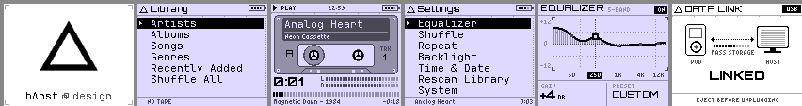
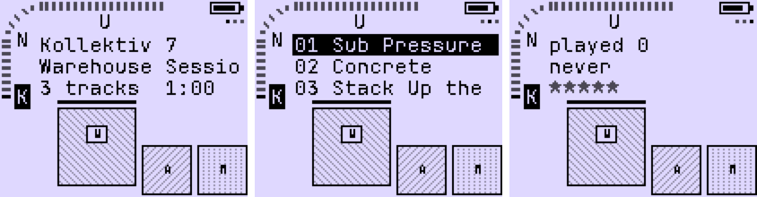
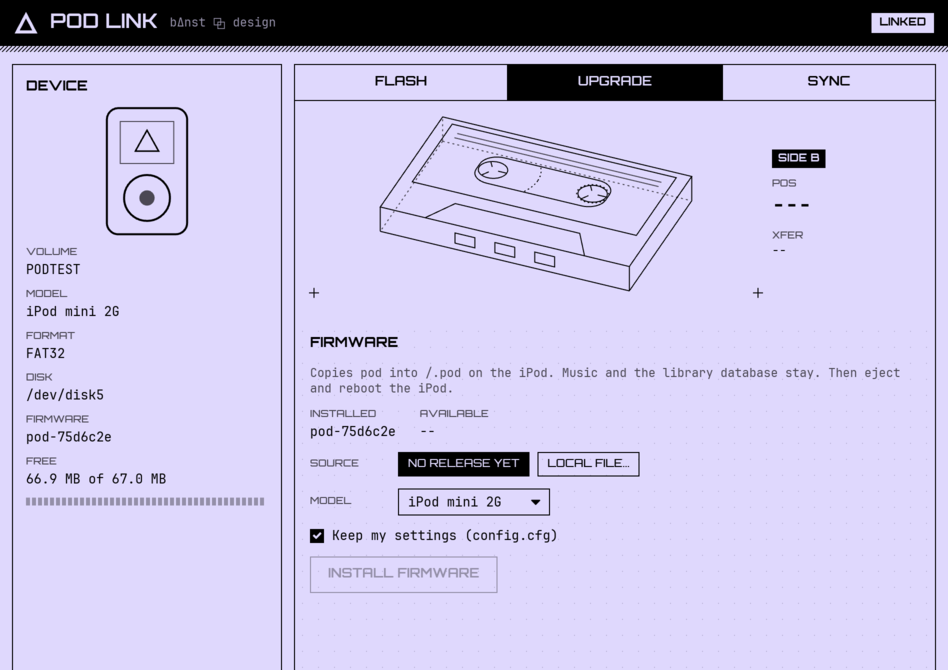

# pod

A stripped-down Rockbox for the iPod mini (1G and 2G) in a cassette futurism
theme. bΔnst ⧉ design.



It boots into a cassette deck with your albums as tapes, by artist then title,
and the player is the same deck in play mode. There is one settings menu, and you open it by holding MENU on the
deck. A double MENU on the deck searches the library.



The deck draws the covers of `/.pod/covers.bin` (SYNC writes them) in a
gallery of the current album and its neighbours, with a generated card for an
album that has none. SELECT steps through three panes beside the bargraph:
the album, its tracks and its stats.

## Controls

| Where        | Button            | Action                                    |
|--------------|-------------------|-------------------------------------------|
| Deck (home)  | wheel             | previous / next tape (queue, mixtapes, then albums) |
|              | << / >>           | previous / next artist initial (hold repeats) |
|              | wheel (Tracks)    | previous / next track                     |
|              | SELECT            | next pane: Details, Tracks, Stats (a mix or the queue: Details only; back to Details after 5 s) |
|              | PLAY              | play the album or mixtape from track 1 (from the selected track in Tracks), open the player (the queue tape: open the player) |
|              | double PLAY       | play it shuffled                          |
|              | hold SELECT       | on an album or mixtape: play next / play last |
|              | MENU              | the player when something plays, else search |
|              | double MENU       | search                                    |
|              | hold MENU         | settings                                  |
| Search       | wheel             | on the strip: A-Z, 0-9, space. In the results: move |
|              | SELECT            | on the strip: add the letter. In the results: pick |
|              | PLAY              | in the results: pick                      |
|              | >> / <<           | into the results / back to the strip      |
|              | MENU              | delete the last letter (none: back to the deck) |
|              | hold MENU         | back to the deck                          |
|              | hold SELECT       | on a track, with something playing: add it at the end of the queue |
| Player       | wheel             | volume (the counter shows the dB value); in Rating the stars, in Up next the list |
|              | SELECT            | next pane: Cover, Rating, Up next (back to Cover after 5 s) |
|              | PLAY              | pause / resume                            |
|              | PREV / NEXT       | skip, hold to cue (SEEK)                  |
|              | MENU              | the deck, on the playing album            |
|              | hold MENU         | the queue                                 |
|              | double SELECT     | love / unlove the track (heart)           |
|              | hold SELECT       | track info / reshuffle                    |
| Queue        | wheel             | move                                      |
|              | SELECT            | pick the track up, SELECT again drops it  |
|              | hold SELECT       | remove the track (picked up: let go)      |
|              | MENU              | back to the player                        |
|              | hold MENU         | settings                                  |
| Equalizer    | wheel             | gain of the selected band (±12 dB)        |
|              | PREV / NEXT       | select band (60, 250, 1K, 4K, 12K)        |
|              | SELECT            | next preset: FLAT BASS SUB WARM VOCAL AIR LOUD |
|              | PLAY              | EQ on / bypass                            |
|              | MENU              | done (saved)                              |

The player is the deck on the playing album: the bargraph round the corner
lit up to the cue position in the track (the volume while the wheel turns),
the battery with the sleep timer's time left beside it, and the pane dots.
SELECT steps through three panes: the Cover with the artist and the album, the
Rating, five stars in half steps that the wheel sets and saves to the tagcache
(smart playlists filter on it) with the number of plays under them, and Up
next, the tracks after the playing one, which the wheel scrolls. Any other pane
goes back to Cover after 5 s. Below them, a band with the track number and
title, the elapsed time in 7-segment digits with the time left beside it
(SEEK while `<<` or `>>` is held to cue, the dB value while the wheel turns),
and a cassette whose hubs turn while it plays. Paused, the digits and the
cassette are grey and still. A double SELECT loves the track (rating 10) and
flashes a heart over the Cover.

The queue is the current playlist. It is the first tape of the deck whenever
there is one, also after a reboot before anything plays, and SELECT on it
plays or resumes it. SELECT on an album still replaces it, and hold SELECT on
an album or mixtape adds it after the playing track (Play next) or at the end
(Play last), staying on the deck. In the player, hold MENU opens the queue as
a list of titles to reorder or trim.

Search matches the first letters of a word of a title, an artist or an album,
ignoring case and accents, and lists the tracks, artists and albums that match
under the letters. An album puts the deck on its tape, an artist on its first
album, and a track plays its album from that track and opens the player,
whose MENU comes back to the tape.

Settings menu: Equalizer, Repeat, Infinite, Sleep, Backlight, Time & Date, Rescan
Library, System (battery, disk, version).

Infinite (off by default) keeps the music going: when the queue runs out and
Repeat is off, up to 10 tracks join its end, picked by tags from the library,
best first: the genre of the last track with a year within 5 and another
artist, the genre with another artist, the genre, anything. A track played
among the last 150 plays or one of the last 32 queue entries is never picked.
The tracks join a few tracks before the end, while the disk is up anyway, and
show in the queue like any other.

Sleep cycles Off, 15, 30, 60 min and Album with each SELECT, and starts
again from the choice. The player shows the time left beside the battery (`Z 27` minutes,
`Z 27S` in the last minute, `Z ALB` until the album is near its end). The last 10 s fade
out, then it pauses, and the idle poweroff turns the iPod off later. Album
pauses at the end of the playing album; shuffled, almost every track ends an
album, so it stops after the track that is playing.

Plays are logged with the time to `/.pod/plays.log` (.scrobbler.log format),
written when the disk is up anyway, so the log never spins it up.

Unplugging the headphones pauses, and plugging them back in leaves it paused.
pod never starts louder than −20 dB.

A track longer than 10 minutes (a podcast, an audiobook, a mix) starts where
you stopped it. PREV takes it back to the start.

## Install

pod lives in `/.pod` and boots `/.pod/pod.ipod`, so it needs its own
bootloader. The stock Rockbox bootloader won't find it. The Apple firmware
stays installed: hold MENU (or switch HOLD on) at power on to boot it.

### With pod link



pod link is a desktop app (macOS, Linux, Windows) that flashes the
bootloader, installs and upgrades the firmware, and syncs a music folder.
Download it from the
[latest release](https://github.com/b4nst/pod/releases/latest)
(`podlink-<os>`), plug the iPod in, and go through the screens in order:

1. UPGRADE copies the firmware into `/.pod`. It keeps your settings and can
   remove a stock Rockbox install.
2. FLASH installs the bootloader, once per iPod. It asks for your password,
   because it writes the firmware partition directly (macOS: the system
   prompt, Linux: pkexec, Windows: UAC).
3. SYNC compares a folder with `/Music` and copies what's new or changed.
   MIRROR also deletes music that isn't in the folder anymore. FORMAT can
   convert lossless files (FLAC, WAV, AIFF, ALAC) to Ogg Vorbis (OGG Q3, Q5
   or Q7, about 110, 160 or 220 kbit/s) to fit more music: tags, ReplayGain
   and cover art are kept, files above 48 kHz are resampled to 44.1 kHz, and
   everything else is copied as it is. What was converted is listed in
   `/.pod/sync.json`, so SCAN finds the library up to date, and changing the
   FORMAT replaces only the files it affects. A converted track is a new file
   to the iPod, which forgets its play count at the next boot; the backup
   below keeps it. SCAN first
   imports the iPod's play log into a history kept per iPod on the computer
   (`podlink/devices/<id>` in the user data folder) and backs up the play
   counts and ratings there. SYNC also writes the mixtapes to `/Mixes` from the
   listening history, at most 100 tracks each and never a track you often
   skip: Heavy Rotation (most played in the last 30 days), Forgotten Gems
   (played 5+ times, not for 180 days), Never Played (a different pick every
   day), Mornings (played 5-11 h) and Nights (played 21-4 h).
   SYNC also writes the covers of the albums on the iPod to `/.pod/covers.bin`
   (square, 44×44 and 28×28, cropped to the centre),
   from the art in the tracks or a `cover.jpg`, `folder.jpg` or `front.jpg` in
   the album's folder.

Eject, and the iPod boots pod. On the first boot pod scans the library, then
restarts by itself once to commit the database. After that it boots straight
into the deck, and new music is picked up at boot.

pod needs a Windows formatted (FAT32) iPod: one restored on a Mac is HFS+,
and pod link says so.

### By hand

1. Download `pod-<target>.zip`, `pod-bootloader-<target>.ipod` and
   `ipodpatcher-<os>` from the
   [latest release](https://github.com/b4nst/pod/releases/latest), or build
   them (below) into `dist/`.
2. Put the iPod in disk mode and unzip `pod-ipodmini1g.zip` (or `-2g`) at its
   root so that `.pod/` sits at the top level. If you're upgrading from
   Rockbox, delete `.rockbox/`. Unzipping replaces `config.cfg`, which resets
   the settings.
3. Install the bootloader once per device. It writes the raw disk, so it asks
   for sudo, and the terminal needs access to removable volumes:

   ```sh
   diskutil list                                          # find the iPod, e.g. disk5
   scripts/install-bootloader.sh ipodmini1g /dev/disk5
   ```

4. Eject and reboot.

## Build

Everything comes from the devenv shell (ARM GCC, host compilers, SDL2,
ImageMagick, fonts):

```sh
devenv tasks run firmware:build                                    # everything -> dist/
devenv tasks run firmware:build --input targets="ipodmini2g ipodpatcher" # pick targets
```

Rockbox is the `firmware/rockbox` submodule, pinned to the revision the
patches apply to. Clone with `git clone --recurse-submodules` (it is shallow),
or `build.sh` initializes it. `build.sh` copies it to `build/rockbox`, applies
`firmware/patches/`, builds without plugins, and repacks `rockbox.zip`. It
drops the stock themes, fonts, icons and languages other than English, and
adds the theme.

### pod link

```sh
devenv tasks run app:run    # release build
devenv tasks run app:test   # fmt, clippy and tests, as in CI
```

`app/core` (`pod-core`) does the work without a UI: device detection,
releases, firmware install, sync, and the bootloader install ported from
ipodpatcher (`core/src/ipod.rs`). Set `POD_IPODPATCHER=dist/ipodpatcher` and
its tests also check that both produce the same bytes on a fake iPod disk.
`app/podlink` is the iced UI. To flash, it runs itself again as root with
`podlink flash-helper`. The `flash-image` example runs that path on a fake
iPod disk image (see the comment at its top).

### Simulator

```sh
devenv shell -- scripts/sim-setup.sh   # builds build/sim from build/src, adds a test library
devenv tasks run sim:test              # firmware:build, sim-setup on build/rockbox, smoke test
devenv shell -- scripts/sim-shot.sh build/shots/x "W200 D S W60 D MM W80 D"
```

`sim-setup.sh` takes another patched tree as an argument, e.g. `build/rockbox`
after `build.sh`. `sim-test.sh` is the smoke test CI runs: it walks a few
screens and fails if a screendump is missing or blank.

`sim-shot.sh` runs the simulator headless and saves screendumps as PNG. The
script is a list of steps: `W<ticks>` wait (100 ticks = 1 s), `D` screendump,
`M S P L R` press MENU/SELECT/PLAY/PREV/NEXT, a doubled letter is a long
press and `2<letter>` a double tap, `F<n>`/`B<n>` turn the wheel (`f<n>`/`b<n>`:
fast), `U` plugs or unplugs USB and `H` the headphones.

## Layout

- `app/`: pod link, the desktop app (Rust, iced): `core/` and `podlink/`, the
  bundled fonts in `assets/`
- `firmware/rockbox`: Rockbox, a submodule at the pinned revision
- `firmware/patches/`: Rockbox changes, applied in order:
  1. simulator scripted input (simulator only)
  2. `%pW` skin tag: reel animation frame, advances every 200 ms of playback
  3. the EQ screen (`apps/gui/pod_eq.c`): five DSP bands pinned to a low
     shelf, three peaks and a high shelf. The plot is the actual biquad
     magnitude response.
  4. navigation: the library is the root (the deck since 25), MENU is back
     (at the root: now playing), `<<`/`>>` do nothing in lists, hold MENU in
     the library or the deck opens the settings menu, the context menus are
     cut down, the first scan reboots by itself
  5. full-screen splash, codecs: MP3, AAC/ALAC, FLAC, Vorbis, Opus, WAV, AIFF,
     WavPack, APE
  6. full-screen "DATA LINK" USB screen in place of the stock logo
  7. with the backlight off, the player redraws at most every 5 s and stops
     polling the peak meters. The mini's LCD has no sleep mode, so it would
     otherwise keep animating in a pocket.
  8. the rename: `/.pod/pod.ipod` in place of `/.rockbox/rockbox.ipod`
     (configure's default `--rbdir` and the mini's boot file), a bootloader
     that shows the Δ splash from power on, "pod" in the UI, and the source
     link and license on the System screen
  9. tagtree buffer pinned so the library labels can't go stale
  10. pauses when the headphones are unplugged and stays paused when they're
      plugged back in, starts at no more than −20 dB
  11. double tap: `BUTTON_DOUBLE` on a second press within 300 ms of a short
      tap, for keymaps that map it. Unmapped, it is a plain press.
  12. no [All tracks] / [Random] rows in the library lists, so an artist's
      albums come by year (`tagnavi_user.config`)
  13. player SELECT scrubs the track (`%pS` skin tag: SEEK in the status row)
  14. library letters: `<<`/`>>` jump to the previous/next initial
      (`ACTION_TREE_LETTER_*`), a fast wheel or a jump shows the letter in a
      box over the list for 600 ms (`apps/gui/pod_letter.c`), and lists of
      more than 64 rows scroll twice as fast
  15. Rescan Library keeps the play stats: exported to the changelog before
      the rebuild, imported after
  16. play log: every play of 3 s or more is a line of `/.pod/plays.log`
      (Audioscrobbler 1.1), kept in RAM and written by the storage idle
      callback (`apps/pod_playlog.c`)
  17. library root: Artists, Albums, Songs, Recently Added, Shuffle All (only
      Albums is left, see 25). `apps/pod_mixes.c` reads
      `/Mixes/<Name>.m3u8`, one absolute `/Music/...` path per line, for the
      deck (23)
  18. PLAY in the library plays the highlighted row (`tagtree_play_selection`,
      an artist's tracks by album) and opens the player, a second tap within
      300 ms reshuffles it (`ACTION_TREE_SHUFFLE`), and the Shuffle setting
      is gone
  19. double SELECT in the player loves the playing track: its tagcache
      `rating` is 10, or 0 to unlove (`ACTION_WPS_LOVE`). `%pH` flashes a
      heart over the cassette for 1 s and a small one by TRK shows while a
      loved track plays. The rating survives Rescan Library (15).
  20. a track longer than 10 minutes resumes where it stopped (tagcache
      autoresume, `pod_autoresumable`), shorter ones start at 0, and the
      autoresume settings are not read
  21. Sleep in the settings menu (`apps/pod_sleep.c`): 15, 30, 60 min or
      the end of the album, with a 10 s fade (`pcmbuf_set_sleep_volume`) and
      `%pZ` for the time left
  22. the cassette deck (`apps/gui/pod_deck.c`), the Albums row (`%deck`): an
      album per tape, with a bargraph of initials, a generated J-card and a
      rack of the next albums. SELECT/PLAY play the album and open the
      player, whose MENU comes back to the deck on the playing album.
  23. mixtapes: each `/Mixes/<Name>.m3u8` is a tape in the deck, ahead of the
      albums under `#`, with a ruled J-card and the `#RULE:<text>` line pod
      link writes at the top of the file on its tape. SELECT/PLAY play it,
      and the Mixes row is gone from the library root.
  24. the queue (`apps/gui/pod_deck.c`, `apps/playlist_viewer.c`): the current
      playlist is the first tape of the deck, with a tracklist card. Hold
      SELECT on an album inserts it (Play next / Play last), and hold MENU in
      the player opens the playlist viewer as an editor: SELECT picks up and
      drops a track, hold SELECT removes it.
  25. the deck is home: it opens at boot and in place of the library lists,
      which `tagnavi_user.config` no longer has, MENU on it does nothing, and
      the tape you left stays after the settings. With no tapes it says so.
  26. search (`apps/gui/pod_search.c`): a double MENU on the deck opens a
      letter strip with the tracks, artists and albums that have a word
      starting with the query, found by scanning the tagcache at each letter.
      A pick puts the deck on a tape or plays the track's album from it.
  27. Infinite in the settings menu (`apps/pod_infinite.c`): when the audio
      thread has no track left to buffer and Repeat is off, it appends up to 10
      tracks picked by tags (`tagcache_get_serial` tells the recent plays) and
      syncs the control file with `playlist_sync_control`.
  28. covers (`apps/gui/pod_covers.c`): reads the index of `/.pod/covers.bin`
      v2 (44x44 and 28x28 per album) and its records through a cache of 16,
      and has helpers to draw them. The deck draws generated cards until the
      new deck draws the covers.
  29. the deck goes by artist, then title, and its letters are the artists'
      initials
  30. the player is the deck in play mode: `%pD` draws the bargraph on the
      queue (or the volume), the J-card and the tape of the playing album
      with turning hubs, the loved heart and its flash, and `%pC` the
      7-segment counter with the time left and SEEK, from `pod_deck.c`. The
      skin adds the title band and the peak meters, and no longer uses
      `%pW`, `%pS` or `%pH`.
  31. deck v2 (`apps/gui/pod_deck.c`): the bargraph in JetBrains Mono, the
      gallery of covers, a small cassette and pane dots in the corner, and
      the Details, Tracks and Stats panes under SELECT. PLAY plays, and MENU
      goes to the player or the search.
  32. the deck loads the library once: again after a tagcache change or USB;
      Stats re-reads its album
  33. player v2: the bargraph on the cue position, and Cover, Rating and Up
      next panes under SELECT (`ACTION_WPS_PANE`, in place of the scrub of 13)
      in `%pD`, the track rating saved to the tagcache, and `%pC` with the
      cassette. The v1 tape, J-card, meters and corner icon are gone.
  34. text in full ink, off indicators in dark grey, light grey only for
      textures: the greys look paler on the LCD than in the screendumps
- `firmware/tools/mktheme.py` + `firmware/tools/canvas.py`: draw every bitmap (splash, USB
  screen, battery, meters) and write the WPS/SBS from the same layout
  constants. `firmware/tools/iso.py`, the old player's cassette, is what pod
  link's cassette is ported from. Levels are ink (0 = bare panel, 3 = full ink): dark on light,
  because a dark background shows up as a frame on the backlit LCD.
- `scripts/build-theme.sh`: rasterizes JetBrains Mono and Orbitron to Rockbox
  fonts and runs the generator. Orbitron's license reserves its name for
  modified versions, so the converted fonts are called Deck.
- `scripts/install-bootloader.sh`: installs the pod bootloader with ipodpatcher
- `scripts/bundle-macos.sh`: wraps the app binary in an ad-hoc signed
  `pod link.app`
- `firmware/device/README.txt`, `firmware/licenses/`: shipped in `/.pod` with the GPL text and
  Rockbox's third party notices (`/.pod/docs`)
- `firmware/theme/`: static files: default `config.cfg`, `themes/pod.cfg`, library
  root (`tagnavi_user.config`)

### CI and releases

`.github/workflows/ci.yml` builds the firmware on Linux in the devenv shell,
runs the simulator smoke test and the app's fmt, clippy and tests, and builds
pod link and `ipodpatcher` for Linux, macOS and Windows (no `ipodpatcher` on
Windows) with the runners' own toolchains, so the binaries don't depend on
`/nix/store`. Pushing a `v*` tag also publishes a GitHub release with all of
it and `SHA256SUMS` (a tag with a `-`, like `v0.2.0-rc1`, is a prerelease). The asset names don't carry the version, so
`releases/latest/download/<name>` always points at the newest build.

### Working on the patches

`build/src` is a working clone on branch `pod` (`build.sh` leaves one in
`build/rockbox`: `git clone --no-local build/rockbox build/src`). Edit and
commit there, then re-export:

```sh
rm firmware/patches/*.patch
git -C build/src format-patch --binary --full-index --zero-commit -N \
  --no-signature -o "$PWD/firmware/patches" \
  $(git -C firmware/rockbox rev-parse HEAD)..pod
```

The flags keep the commit hashes, the series numbering, the abbreviation
length and the git version out of the files. A patch you didn't touch comes
out byte for byte the same, so a change only shows up in the patches it
touches.

To move to a newer Rockbox, rebase `pod` in `build/src` onto it, re-export the
patches, and check the submodule out at the new base:

```sh
git -C firmware/rockbox fetch --depth 1 origin <rev> && git -C firmware/rockbox checkout <rev>
```

## Agent loop

`devenv up` starts `scripts/agent-loop.sh`, which takes issues from a plan to
a merge with four Claude Code agents (`.claude/agents/`). It needs the
`claude` CLI and `gh` logged in. GitHub holds all the state: labels, and
`<!-- pod-agent ... -->` markers at the top of the agents' comments.

| Agent            | Model  | Does                                                    |
|------------------|--------|---------------------------------------------------------|
| `planner`        | Opus   | comments a plan with a definition of done, labels the issue `planned` |
| `implementer`    | Sonnet | implements it on `issue-<n>` and opens the PR, fixes red CI and review findings, rebases |
| `reviewer`       | Opus   | correctness: the plan is done and nothing breaks        |
| `style-reviewer` | Sonnet | the code, commits, patches and docs match the existing ones |

1. Label an issue `ready`. Only your own `ready` counts: the loop checks the
   issue's history for it (`POD_LOOP_APPROVER`, the repo owner by default)
   before planning, and again before opening a PR. The planner comments a
   plan, what the issue waits for (`blocked`, back to `ready` once those are
   closed) or questions (`needs-human`).
2. The implementer takes `planned` issues, one PR at a time
   (`POD_LOOP_WIP`), since patches don't merge as text.
3. Once CI is green, both reviewers comment `approve` or `changes` on the
   head commit. The implementer folds fixes into its commits or replies, and
   the reviewers look again.
4. When both approve the head commit, the loop pushes it to `main`
   fast-forward (a branch that's behind goes back for a rebase), closes the
   issue and deletes the branch.

The loop leaves an issue or a PR labeled `needs-human` alone: a planner or
implementer run that changed nothing, or a PR past `POD_LOOP_MAX_ROUNDS` (5)
fix rounds. Remove the label to hand it back. The agents work in worktrees
under `build/agents/` and log there. Their definitions are read from this
checkout, never from the branch they work on.

The agents run headless with `--permission-mode auto`
(`POD_AGENT_PERMISSION_MODE`), so what they may not do is refused, not asked.
They skip your user settings, whose `ask` rules would refuse every push, and
the loop gives each one the commands its job needs, on its own issue or PR.
Agents only comment. Labels are the loop's, from the marker on each comment,
so an agent can't mark an issue ready. The implementer pushes
its branch once and opens the PR. After that it only commits, because auto
mode won't let an agent rewrite a pushed branch, and the loop force-pushes
it with a lease on the commit it handed out. Nothing but the loop can push
`main` or merge.

## License

pod is Rockbox with patches, so it is GPLv2 or later like Rockbox (see
`/.pod/docs/COPYING.txt` on the device). pod link contains code ported from
Rockbox's ipodpatcher and is GPLv2 or later too. The fonts are under the SIL Open
Font License (`firmware/licenses/`).

## Notes

- The toolchain is nixpkgs' arm-none-eabi GCC 15. Rockbox recommends 9.5, and
  configure warns about it. It runs on a 1G mini.
- Peak meters stay empty in the simulator because its dummy audio driver feeds
  no samples. They should move on the device.
- SCAN empties `/.pod/plays.log` once the lines are in the history, and the id
  that names the iPod is `/.pod/podlink-id`: a reformatted iPod starts a new
  history. Restoring the stats to an iPod is not done yet.
- Play counts are kept per file path: a renamed file starts again from zero.
- Removed codecs still let those files into the library, but they won't play.
